<div align="center">

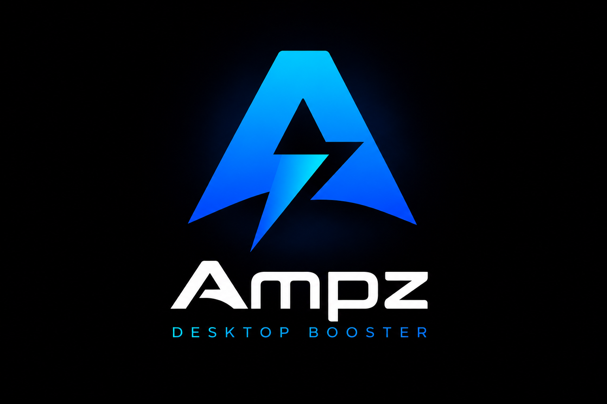

# Ampz Desktop Booster

**A keyboard-first productivity cockpit built around your projects and tasks.**
Your alternative to a wall of monitors — go *deep* on one screen instead of *wide* across glass (and save your neck).
Every virtual desktop becomes a **project** with its own **tasks**, *variables* and *notes* — all one numpad keystroke away, without ever touching the mouse.

[](https://dotnet.microsoft.com/)
[](https://learn.microsoft.com/dotnet/desktop/wpf/)
[](#)
[](#)
[](LICENSE)

<br />

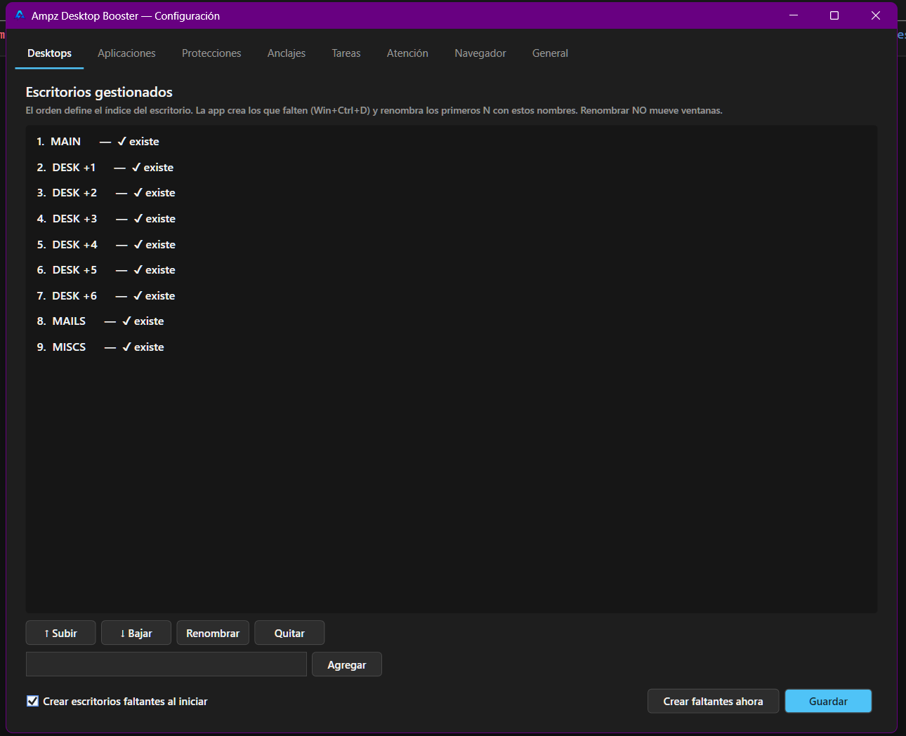

</div>

---

## ✨ What is this?

**An alternative to a wall of monitors.** You know the setup: three, four, five screens fanned around you — and a neck that aches from constantly craning left and right, hunting for the one piece of data you need. More monitors don't give you more focus; they give you more *neck strain*.

Ampz Desktop Booster flips the model: instead of spreading **wide** across glass, you go **deep** on a single screen. Each workspace is one numpad keystroke away, dead ahead — eyes forward, head still. **One screen, infinite depth.**

But the screen is just the vehicle. **The focus is productivity — and productivity here means projects and tasks.** Each virtual desktop *is* a project: it carries the task you're working on, the paths and URLs you need, and the notes you've taken — so switching desktops isn't switching windows, it's switching *context*. You land on a desktop and everything that project needs is already there, behind keys you know by feel.

So while Windows virtual desktops are powerful but *forgettable* — nameless, ordered by position, easy to lose track of — **Ampz Desktop Booster** turns them into a project-and-task workspace:

- 📋 **Projects** — every desktop is a project with a stable identity you reach by **name**, not by position.
- ✅ **Tasks** — pin the live task you're on (from **Vikunja / JIRA / Trello**) to its desktop; it shows in the bar and follows the context.
- 🔗 **Context** — **variables** (paths & URLs) and **notes** resolve to the active project automatically, so your tools are always at hand.
- 🛡️ **Order** — a **window governor** keeps the right apps on the right desktops, so a project's space stays a project's space.
- ⌨️ **Flow** — it's all driven from the **numpad**, for people who don't want to leave the keyboard mid-thought.

It's a **battle-tested workflow**, refined over years of daily use and rebuilt on modern **WPF / .NET 10**. The behavior is the source of truth; the codebase is the polished, maintainable evolution of it.

---

## ⚠️ The trade-off — you sacrifice a numpad

**This is the price of admission. Read it before you install.**

Ampz Desktop Booster **hijacks your numpad.** To make the shortcuts rock-solid, it:

- **Pins NumLock to OFF permanently** — it's suppressed at the hook level, no polling, no fighting.
- **Intercepts every numpad key** and decodes it by *scancode*, so the bindings work regardless of NumLock state.

The consequence is blunt: **while the app runs, your numpad no longer types numbers.** It becomes a dedicated control pad for your desktops — that's the whole point, but it's a one-way street.

> 💡 **Recommendation:** dedicate a numpad to it. Ideally a **separate USB numpad** (or a full keyboard whose numpad you don't use for typing) that you hand over to the app entirely. If your *only* numpad is the one you type numbers with, this tool will fight your muscle memory. A cheap external numpad is the sweet spot — sacrifice it to the desktop gods and never look back. 🎹

---

## 🚀 Features

| | |
|---|---|
| 🎯 **Navigation by name** | `Win+Numpad7` always jumps to **MAIN**, even if you reorder your desktops. Identity follows the name, never the index. |
| 📁 **Projects per desktop** | Assign a project to a desktop and it carries its own variables and notes. Three layers: live session, suggestions, and a durable catalog. |
| ✅ **Task integration** | Pin a live task from **Vikunja**, **JIRA** or **Trello** to a desktop. Multi-account, parallel fetch, shown in the bar widget. |
| 🔗 **Variables (paths & URLs)** | A filterable pool per project + a shared global pool. Grouped by type (folders / URLs), one default per pool, opened to the right monitor. |
| 📝 **Dual notes** | Project/global notes **and** notes linked to the active Explorer folder — annotate a repo and the notes follow the folder, even if you move it. |
| 🛡️ **Window governor** | **Pins** keep an app on its desktop; **restrictions** turn a desktop into a whitelist-only zone. Stray windows are moved automatically. |
| 📊 **System widget** | Live CPU / RAM / battery / network in a real **AppBar** that pushes other windows aside (maximizing never covers it). |
| 🔔 **Per-desktop attention** | External signals (via Named Pipe) raise a quiet, per-desktop alert with a widget dot, toast and sound. |
| 🧰 **Developer quick-actions** | Open terminal here, "Open with", environment variables, a Docker panel, downloads, refresh-rate (Hz) switcher, and more. |
| ⌨️ **100% keyboard** | NumLock is permanently suppressed; the numpad is decoded by scancode so it's rock-solid regardless of NumLock state. |

---

## 📸 A look inside

The **bar** lives at the bottom of every desktop — system stats, the active task, and attention dots — in a real AppBar that other windows can't cover:

<p align="center">
  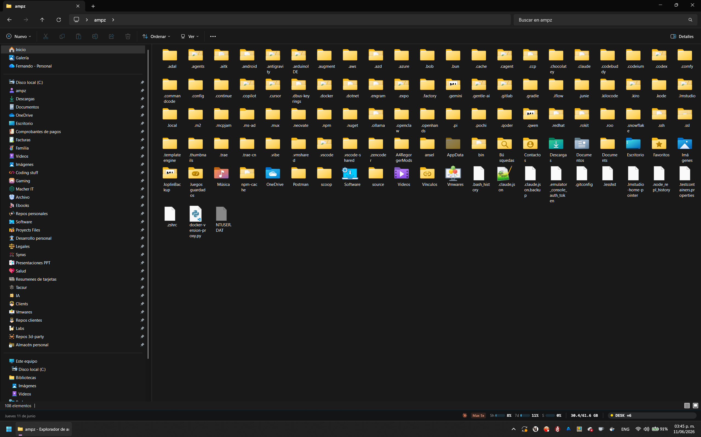
</p>

### 📋 Projects & tasks — the core

<table>
<tr>
<td width="50%" valign="top">
  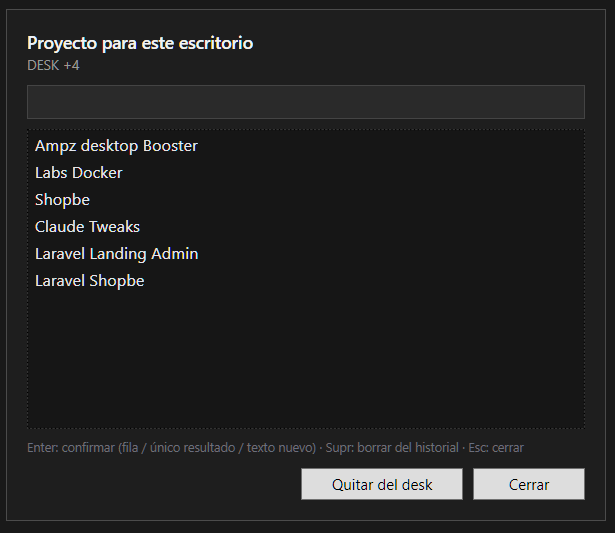<br />
  <b>Bind a project to a desktop</b> — <code>Win+NumpadEnter</code>. The desktop now carries its own context.
</td>
<td width="50%" valign="top">
  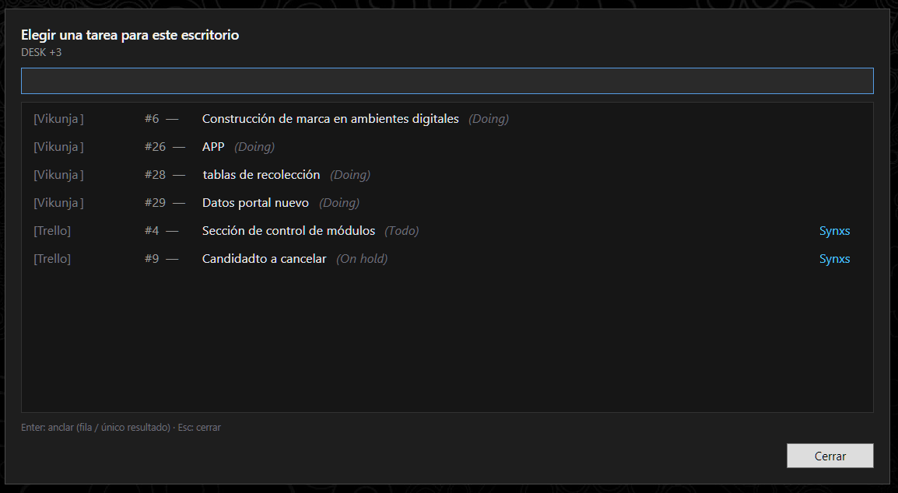<br />
  <b>Pin a live task</b> from Vikunja / JIRA / Trello — <code>Win+NumpadInsert</code>. Re-press to unassign.
</td>
</tr>
</table>

### 🔗 Context that follows the project

<table>
<tr>
<td width="50%" valign="top">
  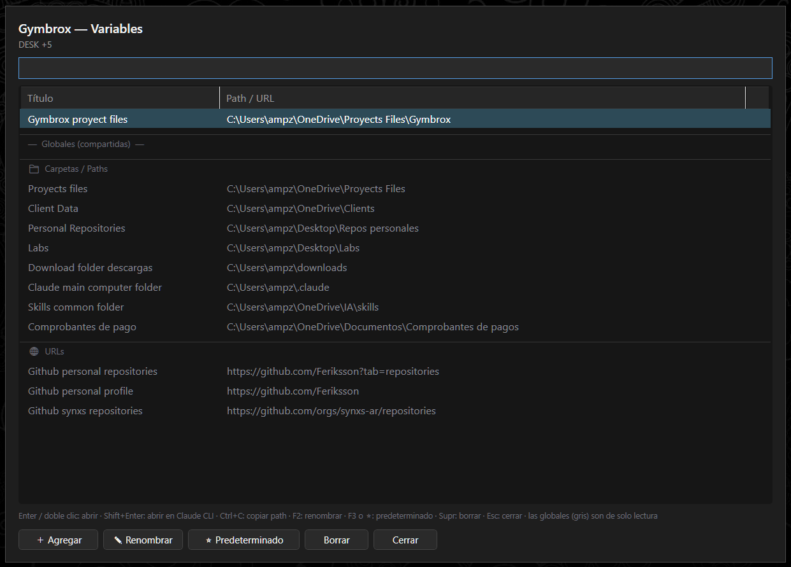<br />
  <b>Variables</b> (paths &amp; URLs), grouped by scope and type — <code>Win+Numpad✱</code>.
</td>
<td width="50%" valign="top">
  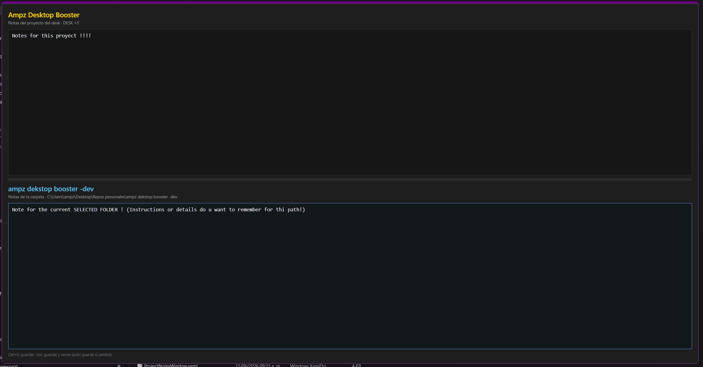<br />
  <b>Dual notes</b>: project notes + active-folder notes — <code>Win+Numpad/</code>.
</td>
</tr>
</table>

### ⌨️ Keyboard, made memorable

<table>
<tr>
<td width="50%" valign="top">
  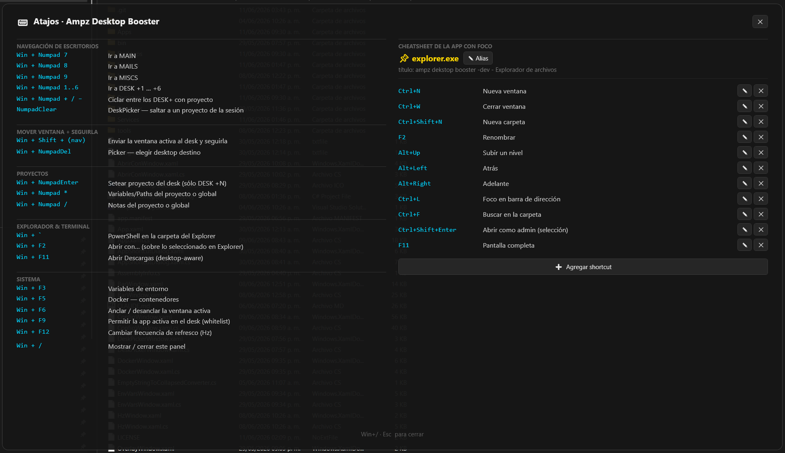<br />
  <b>A built-in cheatsheet</b> — every shortcut, one keystroke away. No memorizing alone.
</td>
<td width="50%" valign="top">
  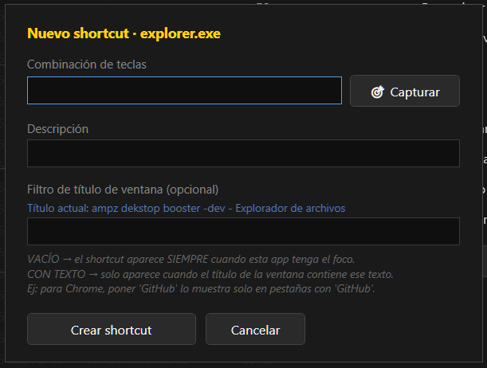<br />
  <b>Add your own shortcuts</b> for the apps and paths you reach for most.
</td>
</tr>
</table>

### 🧰 Developer quick-actions

<table>
<tr>
<td width="33%" valign="top">
  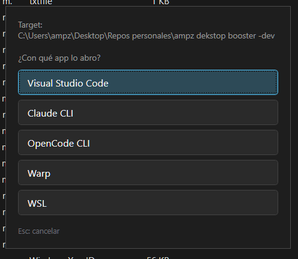<br />
  <b>Open with</b> — <code>Win+F2</code>.
</td>
<td width="33%" valign="top">
  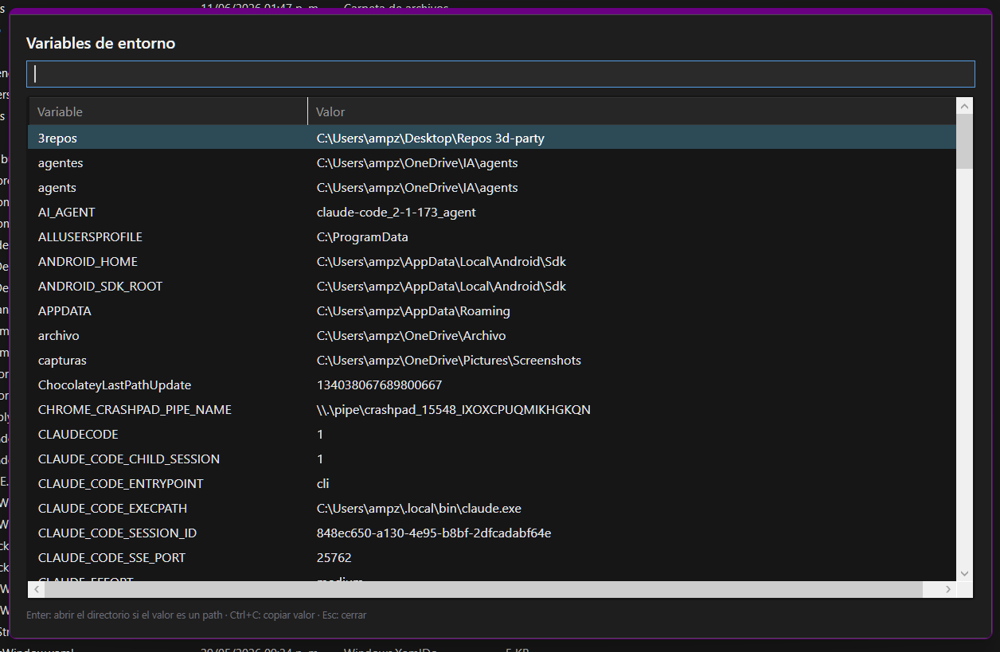<br />
  <b>Env vars search</b> — <code>Win+F3</code>.
</td>
<td width="33%" valign="top">
  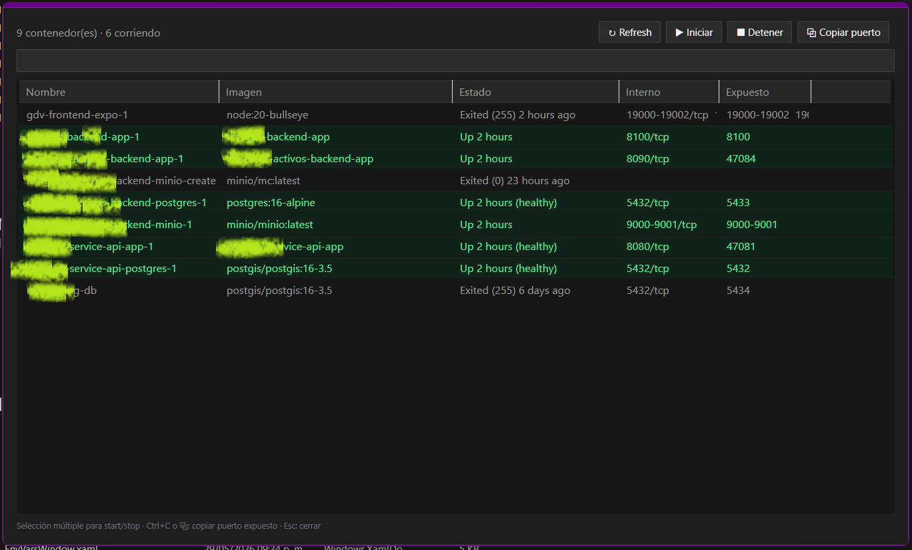<br />
  <b>Running containers</b> — <code>Win+F5</code>.
</td>
</tr>
</table>

---

## 🎹 Keyboard map

| Shortcut | Action |
|---|---|
| `Win + Numpad 1..9` | Go to the desktop that **owns that key** — a fixed desktop (keys are configurable in Config → Desktops; defaults `1 / 2 / 3` → **MAIN** / **CONSOLES** / **MISCS**) or a dynamic one opened by the launcher, which takes the lowest free key |
| `Win + Shift + (navigation)` | Send the active window to that desktop **and follow it** |
| `Win + NumpadEnter` | **Launcher** — pick a project, then its context: creates a dynamic desktop for that pair (or jumps to it if it is already open). Re-press with the launcher open closes it and, on a dynamic desktop, removes that desktop |
| `Numpad 5` *(CLEAR, no Win)* | Open the **Playbook** — play, look up and track your knowledge libraries. Re-press closes it from the search view; mid-session it just brings it back to the front |
| `Win + Numpad *` | **Variables** (Paths Manager) — re-press fires the default |
| `Win + Numpad /` | **Notes** (project/global **+** active-folder notes) |
| `Win + Numpad −` | **Send-window picker** — choose a target desktop for the active window |
| `Win + Numpad +` | **Services** of the current scope — what is running and how to start it; re-press starts whatever is missing |
| `Win + Numpad 0` *(Insert)* | **Task picker** — assign a task; re-press **unassigns** it (toggle) |
| `Win + Numpad .` *(Del)* | Open the **configuration** window (or bring it to the front) |
| `Win + F2` | "Open with" (over the active Explorer path) |
| `Win + F3` | Environment variables |
| `Win + F5` | Docker panel |
| `Win + F6` | Toggle pin on the active window (full pin management lives in Config → Pins) |
| `Win + F9` | Whitelist the active app on the current desktop (protections are managed in Config → Protections) |
| `Win + F11` | Open Downloads |
| `Win + F12` | Refresh-rate (Hz) picker — re-press cycles, releasing `Win` applies |
| `` Win + ` `` | Open a terminal in the current Explorer path |
| `Win + /` | **Shortcuts helper** — the built-in cheatsheet, with search; re-press closes it |
| `Win + D` | Intercepted — a custom "show desktop" that minimizes everything **except the bar** |
| `F1` *(no Win)* | Swallowed, so it never pops the Windows Help of the active app |

> `Win + F7` (Pin Manager) and `Win + F8` (Desktop restrictions) were retired: both now live in the configuration window. The Desk Picker that used to sit on `Numpad 5` is still in the code, currently without a shortcut.

---

## 📚 Knowledge libraries — grow while you work

The bar is not only about getting things done; it is also a place to get *better* at what you do. Keep the concepts and vocabulary of your field in **libraries**, and play them without leaving the keyboard.

- **Libraries** are a tree — nest them however you think (`Law › Contracts`, `English › Business`).
- Each library holds **cards** (front / back) and **vocabulary terms** (word, word type, definition, usage context, origin, and a translation per language — you add the languages you study).
- Every entry has one **nature** (technical, legal, general… your own growing list), inherited from its library unless you set one, so you can also play "everything legal" across libraries.

**Press `Numpad 5` (CLEAR) to open the Playbook.** Type to find a library, a nature or a single entry. `Enter` plays a library or opens an entry to read it — and if what you typed does not exist yet, it lets you add it on the spot. In a round you choose which side is shown first (front, back, mixed, or a language), `Space` reveals the answer, and the top-row keys `1`–`4` say how it went: *I don't know*, *I had doubts*, *Good, could be better*, *Spectacular*. `Esc` ends the round whenever you want; `F2` shows your statistics.

**It is deliberately not a spaced-repetition scheduler.** There are no due dates and nothing piles up while you are away. Each entry has a **solidity** from 0 to 100, derived from your whole review history: it wears down slowly when you do not use it — never to zero just because time passed — and rounds simply lean towards whatever is weakest. Statistics (by library, by nature, and over time) are a mirror of where you stand, not a to-do list.

**Managing libraries** happens in the configuration window (`Win + Numpad .`), tab **Knowledge**: create, rename, nest, move and delete libraries, add and edit entries, and maintain your natures and languages.

**Import / export** lives in the same tab. A library (with all its sub-libraries) or everything at once is exported to a single, readable JSON file that carries the *content only* — never your review history or solidity — so it is safe to share. Importing shows a preview first and lets you choose, when a name already exists, between importing as a **copy** or **merging** into the existing library (which only adds what is missing). An import either goes in completely or not at all.

---

## 🧠 Core concepts

A few ideas make the whole thing click:

- **Identity by name, not index.** Desktops are matched by a case-insensitive name fragment. Move them around all you want — `Win+Numpad7` still lands on MAIN.
- **The three project layers.** *Session* (what's on each desk today, ephemeral) → *Suggestions* (last assignment, to pre-fill the setter) → *Catalog* (durable history, paths & notes). The session is **never** auto-filled from disk at startup — seeing yesterday's unconfirmed projects would be confusing.
- **Dual scope.** On a `DESK +N` with an active project, variables and notes resolve to **that project's** pool. Anywhere else (MAIN/MAILS/MISCS, or an empty DESK+) they fall back to a **shared global** pool.
- **Folder-linked notes.** Notes are keyed by the *folder name*, not its full path — so moving a repo from `Desktop` to `D:\` keeps its notes.
- **The window governor.** Listens for window-show events and desktop changes; a pinned app that appears off its desk is moved back, and a restricted desk only admits its whitelist.

---

## 🛠️ Getting started

### Requirements

- **Windows 10 / 11** (x64)
- **.NET 10 SDK** (`net10.0-windows`)
- A 64-bit machine — the bundled `VirtualDesktopAccessor.dll` is x64-only
- **A numpad you can sacrifice** — see [The trade-off](#️-the-trade-off--you-sacrifice-a-numpad). A dedicated/external numpad is strongly recommended; the app takes it over completely (NumLock stays OFF).

### Build & run

```powershell
# Build (x64 is set by config — no need for -p:Platform)
dotnet build AmpzDesktopBooster.csproj

# Run
dotnet run --project AmpzDesktopBooster.csproj
```

The app is **single-instance** (global mutex). If one is already running, the second copy warns and exits — kill the previous instance before relaunching, or you'll have two keyboard hooks fighting each other.

> The `.slnx` solution also opens directly in Visual Studio.

---

## 💾 Where your data lives

All user data lives in **`%APPDATA%\AmpzDesktopBooster\`** — never next to the executable, so the app stays portable and the binary immutable.

| File | Format | Contents |
|---|---|---|
| `desk_project_data.json` | JSON | Durable catalog: history, notes, paths, shared notes/paths, **folder notes** |
| `settings.ini` | INI | Project suggestions, pins, restrictions, whitelists |
| `desktops.json` | JSON | Managed desktop list + auto-create flag |
| `apps.json` | JSON | User apps for "Open with" |
| `tasks.json` | JSON | Task accounts (Vikunja / JIRA / Trello) |
| `widgets.json` | JSON | Which bar widgets are enabled |
| `knowledge.db` | SQLite | Knowledge libraries: cards, vocabulary terms and the full review history |
| `ampz-crash.log` | text | Unhandled-exception log (next to the **exe**) |

Every config follows the same resilient pattern: load with a try/catch fallback to defaults, save silently — **a corrupt file or a failed disk write never takes the app down.** The knowledge database is the one store that is not JSON (its review history grows without bound), and it keeps the same promise: an unreadable file is moved aside, never deleted.

---

## 🏗️ Architecture

Strict layer separation — each piece knows only what it must:

| Folder | Responsibility |
|---|---|
| `Desktops/` | Core: virtual desktops, projects, pins, restrictions, window governance |
| `Hotkeys/` | Low-level keyboard capture and routing of shortcuts to actions |
| `Interop/` | All native P/Invoke: the DLL, hooks (`WH_KEYBOARD_LL`, WinEvent), window methods |
| `Persistence/` | Data paths, custom INI reader, project catalog model |
| `Apps/` | External apps: detection, "Open with", Docker, quick actions, Explorer context |
| `Services/` | AppBar, tray, autostart, system monitor, toasts, tasks, attention, icons |
| `Providers/` | AI-provider logos (embedded resources) |
| `Knowledge/` | Knowledge libraries: model, SQLite store, solidity and statistics, import/export format |
| `Themes/` | Shared XAML resource dictionaries (dark scrollbar, knowledge dialogs) |
| *root* | The WPF windows (`*.xaml`) and `App` |

Highlights worth knowing:
- The keyboard hook lives **on the UI thread on purpose** — that's where WPF pumps the messages `WH_KEYBOARD_LL` and the native DLL need.
- Hook callbacks are never blocked: real work is deferred to the `Dispatcher`.
- `DesktopService` is the only layer that touches the native desktop P/Invoke; `SystemMonitor` knows nothing about WPF; `DesktopService` doesn't know about persistence (the project lookup is injected).

### Built with

- **.NET 10** · **WPF** (UI) · **WinForms** (tray icon only)
- **[NAudio](https://github.com/naudio/NAudio)** — attention-sound playback with real volume control
- **[Microsoft.Data.Sqlite](https://learn.microsoft.com/dotnet/standard/data/sqlite/)** — the knowledge-library database
- **VirtualDesktopAccessor.dll** — third-party native library for the undocumented Windows virtual-desktop API

---

## 📜 License

**Proprietary — personal use only.** See [LICENSE](LICENSE).

You may download and use this software for personal, non-commercial purposes. You may **not** sell it, redistribute it, or distribute modified versions. All rights not expressly granted are reserved by the author.

*This is intentionally **not** an open-source license: the source is public so you can read and use it, but the rights stay reserved.*

---

## 🙏 Acknowledgements

- **VirtualDesktopAccessor** — for exposing the virtual-desktop API Microsoft never documented.

<div align="center">
<sub>Built for developers who keep their hands on the keyboard. 🎹</sub>
</div>
